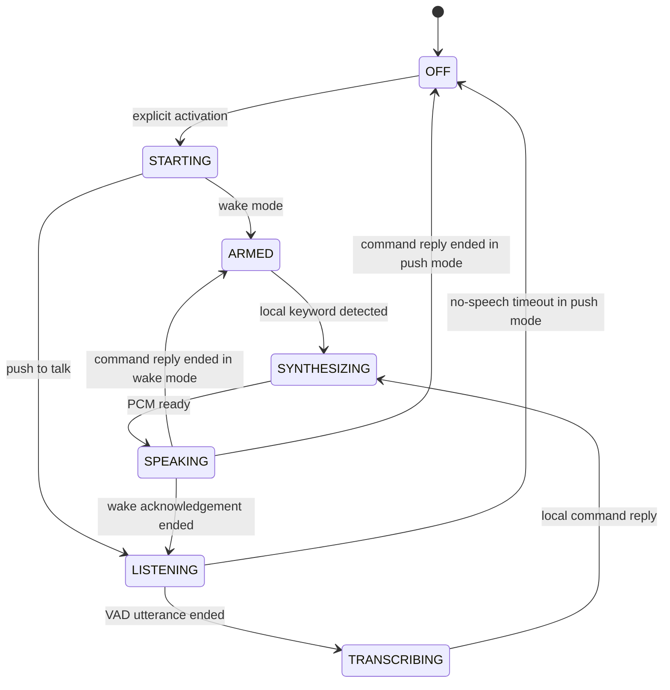

# Phase 2: local voice

This milestone adds an opt-in local speech loop while retaining the Phase 1
ferrofluid renderer and all desktop controls. It provides a command demo, not a
general conversational LLM. The next phase adds the hybrid AI/tool core.

## Runtime and compatibility

- **STT:** multilingual Whisper tiny, quantized ONNX encoder/decoder, Romanian or English.
- **Wake phrase:** streaming English Zipformer keyword model, initially `jarvis`.
  The shipped SentencePiece unigram scores determine the exact keyword tokens;
  greedy token splitting was rejected after a real detection regression failed.
- **VAD:** local energy detection, 120 ms onset hysteresis, 250 ms minimum voiced
  duration, pre-roll, 700 ms trailing silence and a 12-second utterance limit.
- **TTS:** local Piper Mihai (Romanian) and Amy (English). A separate optional
  macOS adapter synthesizes installed system voices to PCM WAV using `/usr/bin/say`.
- **Execution:** the pure `sherpa-onnx@1.13.8` WASM package in a dedicated Node
  worker. The checked `sherpa-onnx-node` addon requires macOS 15; older checked
  releases require 13+. They are not dependencies. Electron stays at 43.8.3,
  Node at 22.23.4 and the Intel deployment target at 12.0.

No Python process is required for this speech milestone. This keeps the user's
existing launcher and Monterey compatibility. Python 3.12/FastAPI remains the
planned orchestration backend for the next phase. Speech boundaries are separated
from UI logic and can be adapted to that backend.

Whisper is the provided recognizer; additional STT providers remain future work.
Piper and macOS system voices are selectable TTS providers. Language, wake phrase,
rate and microphone device are configurable. Installed system voices depend on
the Mac's configuration; missing voices produce a clear error. The system adapter
has not been executed on a Mac in this session.

## Session flow



Any active phase can be stopped. Stop increments a session generation, terminates
the worker, aborts system synthesis, clears timers, stops playback and releases
microphone tracks. Late results from cancelled generations cannot restart audio.
The owning window's hide/minimize/close and application quit use the same cleanup.
No automatic wake listening is restored on app launch.

Capture uses a mono 16 kHz AudioWorklet with bounded 2048-sample packets. The main
process validates every packet and checks the owner. Backpressure allows at most
one live capture operation; it cannot accumulate an unbounded message queue.
Only the VAD-selected utterance enters Whisper. No microphone samples are saved
to disk. The last recognized phrase and reply stay in memory and are not persisted.

During speech output, capture frames are ignored to avoid the assistant waking
itself. Actual playback passes through Web Audio's analyser; its scalar amplitude
drives `SPEAKING`. Microphone samples drive `LISTENING`. Manual interruption is
available; automatic acoustic barge-in and token-streaming transcription are not
implemented. Silence timeout returns wake mode to `ARMED` or stops a push session.

## Models and privacy

The user explicitly starts the approximately 268 MB model download. Official
GitHub release URLs, archive sizes, SHA256 values and individual file hashes are
pinned in `configs/voice-models.json`. Archive paths are checked before extraction,
all extracted files are verified, and a model-integrity check runs before inference.
TLS/checksum verification is never disabled. Download failures can be retried.

Development model files live in `.cache/voice-models`; packaged apps use their
application-data `voice-models` directory. `JARVIS_VOICE_MODELS_DIR` is an optional
trusted development/test override. Model files, dependencies, test output and
caches are excluded from Git. Upstream model cards remain alongside the weights.
See those cards for model/dataset licensing; weights are downloaded from upstream
and not redistributed in this repository.

There is no cloud speech endpoint, API key, browser SpeechRecognition fallback,
camera capture or microphone upload. Model downloads send only requests for
fixed public assets. Temporary WAV files in the system adapter contain generated
speech only and are removed after decoding.

## Commands and limits

Supported examples: `Cât este ceasul?`, `Deschide panoul de control`, `Salut`,
`Oprește`; English equivalents work with the English setting. Replies use the
machine's local clock. The deterministic command registry can only return a
spoken reply, open JARVIS's own dashboard or mute voice. Text never becomes a
shell command. Unknown requests explain the current capability.

Whisper tiny trades recognition quality for a small model and CPU cost. Romanian
words can be misrecognized. Tests check the intended clock intent, not perfect
transcription. Try a quieter microphone, a clear phrase or push-to-talk. Older
Intel CPUs need a native latency check; Eco/reduced motion remain available.

An initial mixed greeting/command synthetic Romanian fixture was unstable. A
Whisper base comparison did not consistently improve that recording, so the
larger model was not added to the download. Lower-variability Piper settings and
the documented single command `Cât este ceasul?` passed five consecutive real
inference checks. Recognition still sometimes omits words; tests verify the
clock intent instead of claiming perfect Romanian transcription.

## Verification

```sh
npm run voice:models
npm run voice:check
npm test
npm run build
npm run test:e2e
```

`voice:check` performs five real checks: English synthesis and transcription,
Jarvis detection, Romanian synthesis and transcription. It writes synthetic test
WAVs with silence to `.cache/voice-fixtures` for the Electron capture test.
The Electron test additionally exercises the full capture → VAD → Whisper →
command → Piper → measured playback path, wake acknowledgement, and cancellation
during actual inference. Those checks use synthetic microphone input, not the
user's physical microphone. No test asserts that `/usr/bin/say` worked in Linux.

On the target Monterey Mac, download the models in the dashboard, test both
languages and wake/press-to-talk modes, then stop while thinking and speaking.
Confirm the system microphone indicator clears after mute/hide/quit. Check any
installed macOS voice separately. This native Phase 2 check remains outstanding.
